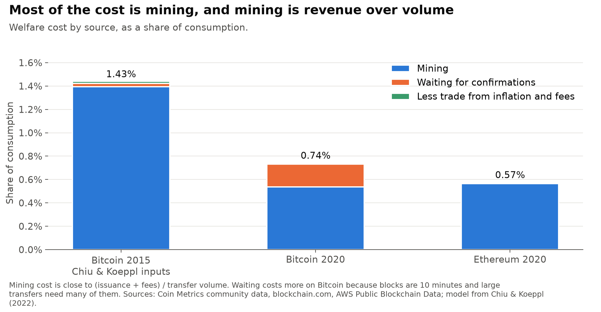
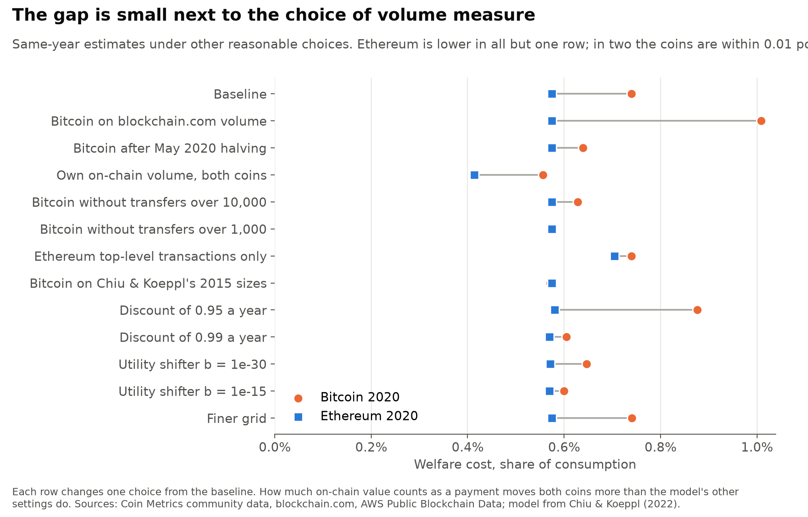
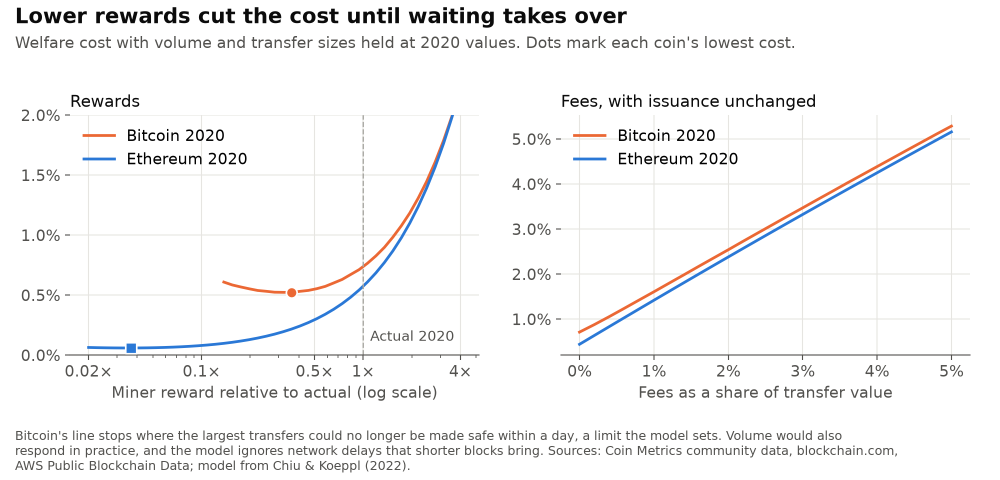
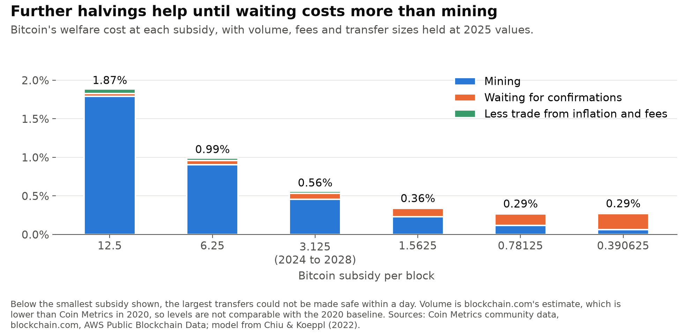
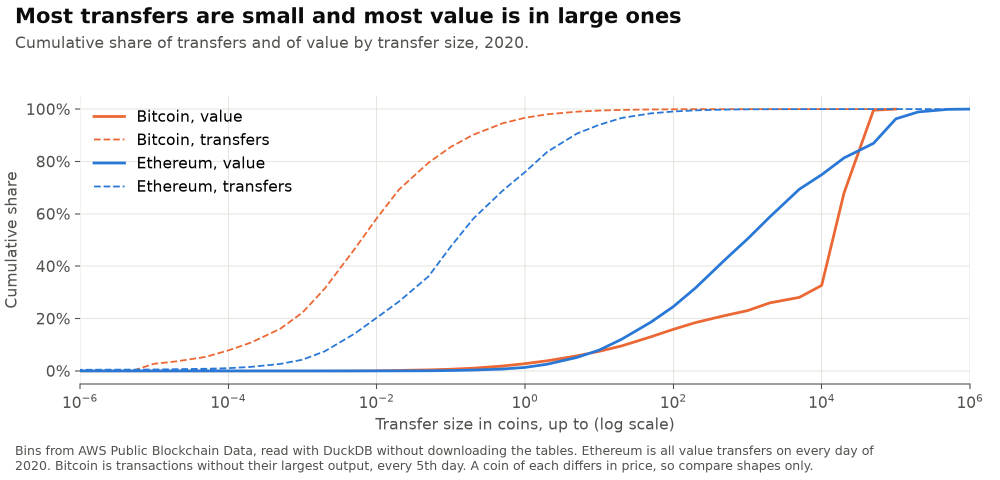

# pow_welfare_cost

[](https://github.com/atamalfuzi/pow_welfare_cost/actions/workflows/tests.yml)

Chiu & Koeppl built a model of how Proof-of-Work blockchains settle payments and used it to measure the welfare cost of Bitcoin. This project checks what the same model says about Ethereum while it still ran on Proof of Work, and compares the two coins on the same year, 2020. Python, with NumPy and DuckDB.

> **Personal project.** This is my own analysis of publicly available data. It is not associated with my work for any current or past employer and does not represent their views.

| Question | Answer |
|---|---|
| What did Proof of Work cost in 2020? | 0.74% of consumption for Bitcoin and 0.57% for Ethereum, against an ideal payment system. |
| Where does the cost come from? | Mostly mining, which is close to miner revenue over transfer volume: 0.54% and 0.57%. The rest is waiting for confirmations. |
| Which costs less? | Ethereum in most checks, by a margin that rests on Bitcoin's largest transfers. |
| What do rewards and fees do? | Each point of fee share adds about a point of cost. Lower rewards help until waiting takes over. |
| What about later years? | Bitcoin cost 0.56% in 2025. The model does not cover Ethereum after the Merge. |

Welfare cost is the share of consumption people would give up to avoid the system's costs, compared with an ideal payment system.

## The model

A day has as many short periods as it has blocks. A buyer who meets a seller chooses how much to pay and how many blocks to wait before the seller hands over the goods. Double-spending does not pay as long as the payment is no larger than N(N+1)R, where N is the wait in blocks and R the reward per block. Free entry means miners spend about what they earn, so the reward is a real cost. The distribution of transfer sizes pins down how much buyers value trade, and welfare follows from their choices.

With Chiu & Koeppl's Bitcoin 2015 inputs, `model.py` gives a welfare cost of 1.43%. That is 481 times the cost of a cash system with 2% inflation, and the same welfare as 234% inflation. A test checks these.

For Ethereum the inputs change: 6,480 blocks a day instead of 144, a discount of 0.97 a year spread over those blocks, issuance including uncle rewards, and its own volume, fees and transfer sizes.

## Bitcoin and Ethereum in 2020



| 2020 | Bitcoin | Ethereum |
|---|---:|---:|
| Daily chance of a trade (sigma) | 0.0131 | 0.0279 |
| Annual supply growth | 2.49% | 4.56% |
| Fee share of transfer value | 0.030% | 0.134% |
| Welfare cost | 0.74% | 0.57% |
| of which mining | 0.54% | 0.57% |
| of which waiting for confirmations | 0.20% | 0.01% |
| of which less trade from inflation and fees | 0.01% | under 0.01% |
| Range from resampling days, 95% | 0.73% to 0.75% | 0.57% to 0.58% |
| Multiple of a 2%-inflation cash system | 136× | 476× |
| Inflation with the same welfare | 83% | 215% |
| Value-weighted wait | 23 blocks, about 3.8 hours | 39 blocks, about 9 minutes |

Mining cost is close to miner revenue divided by transfer volume, and on that measure the two coins were about equal in 2020. Ethereum's lower total comes from waiting. Its blocks are much shorter, so large transfers wait far less clock time even though they wait more blocks.

The year matters. Against Chiu & Koeppl's 2015 figure of 1.43%, Ethereum would look much cheaper, but Bitcoin's subsidy fell from 25 to 6.25 coins a block between 2015 and 2020.

The multiple and the inflation figure point the other way, and they should not be used to rank the coins. Inflation costs less when money changes hands more often. Ethereum's sigma is about twice Bitcoin's, so its 2% benchmark cost is much smaller, and the same loss shows up as a larger multiple.

## How firm the comparison is



| Change from the baseline | Bitcoin | Ethereum |
|---|---:|---:|
| Baseline | 0.74% | 0.57% |
| Bitcoin on blockchain.com volume, Chiu & Koeppl's source | 1.01% | 0.57% |
| Bitcoin after the May 2020 halving only | 0.64% | 0.57% |
| Own on-chain volume for both | 0.56% | 0.41% |
| Bitcoin without transfers of 10,000 BTC or more | 0.63% | 0.57% |
| Bitcoin without transfers of 1,000 BTC or more | 0.58% | 0.57% |
| Ethereum top-level transactions only | 0.74% | 0.70% |
| Bitcoin on Chiu & Koeppl's 2015 transfer size table | 0.57% | 0.57% |
| Annual discount 0.95 | 0.88% | 0.58% |
| Annual discount 0.99 | 0.61% | 0.57% |
| Utility shifter b = 1e-30 | 0.65% | 0.57% |
| Utility shifter b = 1e-15 | 0.60% | 0.57% |

Ethereum is lower in all but one row. With Chiu & Koeppl's 2015 transfer sizes, Bitcoin is lower by less than 0.01 points (0.572% against 0.575%). Without its transfers of 1,000 BTC or more, the two are level.

The gap rests on Bitcoin's largest transfers and on the model's utility shifter b. On the sampled days, 1,303 transfers of 10,000 BTC or more hold 67% of measured Bitcoin value. Many of them are probably large holders moving their own coins, not payments, and the rule that drops each transaction's largest output cannot tell the two apart. Bitcoin's volume measures also differ by a factor of three (153,000 to 489,000 BTC a day), and a mismatched pair, such as my on-chain Bitcoin volume against Coin Metrics for Ethereum, reverses the order. I read this as: Ethereum was somewhat cheaper in 2020, and the data do not support a confident claim about how much.

The tests check that the grid and the one-day limit on confirmations do not bind in any calibrated block, that no buyer gains from a contract that invites double-spending, and that the grid converges.

## Rewards and fees



Holding volume and transfer sizes at 2020 values:

- **Fees.** Each extra point of fee share adds about a point of cost. Paying the same total reward through fees or through new coins makes almost no difference.
- **Rewards.** Lower rewards cut mining cost but lengthen waits. Bitcoin's lowest cost is 0.52% at about 0.36 times its 2020 reward. Ethereum's is 0.06% at about 0.04 times, because waiting is cheap with short blocks. The model leaves out network delays and the stale blocks that short blocks cause, so that second figure flatters Ethereum.

### Bitcoin after the 2024 halving

On blockchain.com's volume, the only measure still public for these years, the cost fell from 1.34% in 2015 to 1.01% in 2020 and 0.56% in 2025. April 2024 to October 2026 gives 0.55%. The 2025 multiple is 15× and the equal-welfare inflation 19%, both much lower because low volume makes sigma small.



At 2025 volume and fees, further halvings would take the cost to 0.36% at 1.5625 coins per block and 0.29% at 0.78. After that it stops falling, as waiting costs more than mining. These hold volume fixed, which is a strong assumption over decades.

### Ethereum after the Merge

The model stops applying here. Its double-spend limit comes from an attacker racing miners, and its mining cost comes from free entry into hashing. Staking has neither, so I do not report a model result for Ethereum after September 2022.

A rough range for 2025 is 0.01% to 0.10%. The low end treats validator income as a pure transfer, leaving only the 12.8-minute wait for finality and the effect of supply growth and fees. The high end treats all validator income as used up, as free entry does with mining. Neither end comes from the model. Volume here is unadjusted on-chain value (3.2 million ETH a day), which ran 1.4 times Coin Metrics' adjusted figure in 2020.

## Limits

- Transfers are not all payments. Exchange movements and contract activity count as volume, and the result depends directly on how much of it does.
- Ethereum's volume counts ether only. Token transfers pay fees but their value is not in the denominator, which overstates Ethereum's cost.
- Volume does not respond to rewards or fees, and prices do not move.
- Mining cost counts resources equal to miner revenue. It leaves out effects on anyone outside the model, such as emissions.
- Waiting cost scales with the utility shifter b, which has no empirical anchor. It is Chiu & Koeppl's 1e-60.

## Data

Run `data.py` to rebuild `results/inputs.csv` and compare it with `settings.py`. Raw Coin Metrics files are not committed (CC BY-NC).

- **Supply, issuance, fees, block and transaction counts:** [Coin Metrics community data](https://coinmetrics.io/community-network-data/).
- **Adjusted volume:** Coin Metrics no longer gives `TxTfrValAdjNtv` to the community tier. Bitcoin's comes from a Wayback Machine copy of its community file, and its 2020 figures match a January 2021 copy. Ethereum's comes from a May 2021 copy of the community file. I found no public archive of that one, so `data.py` needs it at `data/eth_coinmetrics_2021.csv`, and otherwise the value stays as recorded in `settings.py`.
- **Bitcoin estimated transaction value:** [blockchain.com charts API](https://www.blockchain.com/explorer/charts/estimated-transaction-volume).
- **Transfer sizes:** [AWS Public Blockchain Data](https://registry.opendata.aws/aws-public-blockchain/), read by `histogram.py` through DuckDB with unsigned requests and keeping only bins, in `results/hist_*.csv`. Ethereum covers every day of the year. Bitcoin's nested outputs are slow to read, so 2020 uses every 5th day and 2025 every 10th. Bitcoin payments are approximated as transactions without their largest output.



## Sources

The model is from Chiu & Koeppl, "The Economics of Cryptocurrencies: Bitcoin and Beyond", *Canadian Journal of Economics* (2022), [doi:10.1111/caje.12625](https://doi.org/10.1111/caje.12625). Their replication package is at [doi:10.5683/SP3/3WEFMJ](https://doi.org/10.5683/SP3/3WEFMJ). `model.py` is my own Python implementation of the method, and their code is not included here.

## Run it

```bash
python -m venv .venv
.venv\Scripts\activate          # Windows; on macOS or Linux: source .venv/bin/activate
pip install -r requirements.txt
python run.py
python figures.py
```

`run.py` takes about two minutes and uses the committed bins. `histogram.py` and `data.py` rebuild the inputs: `python histogram.py eth 2020` takes about 15 minutes and a Bitcoin sample about an hour. The range from resampling days needs the daily bins in `data/`, so that step is skipped if you have not rebuilt them.

To run the tests: `pip install -r requirements-dev.txt`, then `pytest`. They use committed files and need no downloads.

## License

Code: [MIT](LICENSE).
